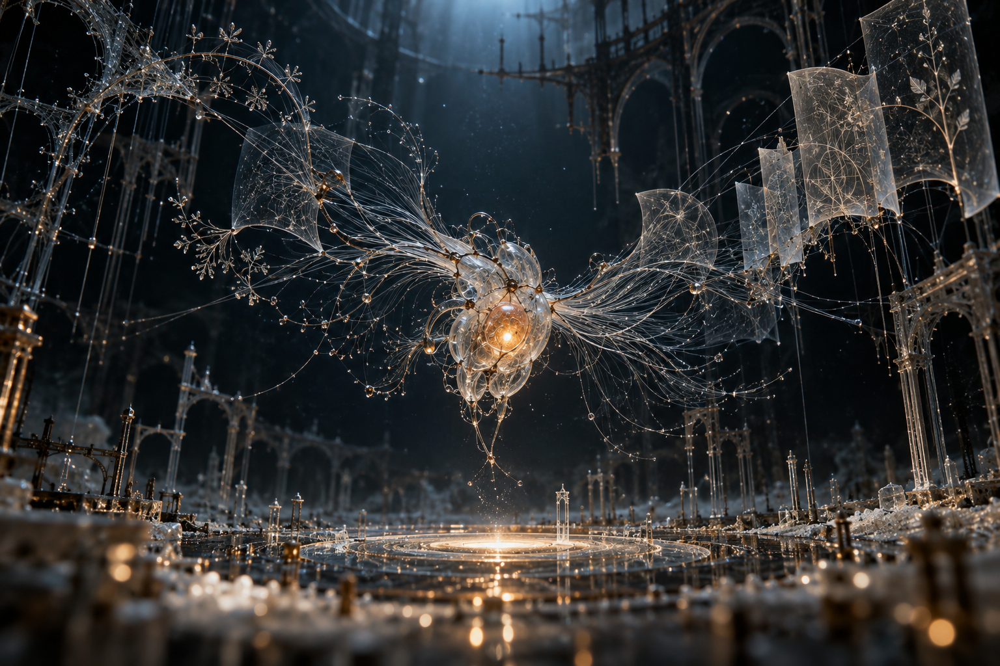

# 评测报告：MJ-思想成句前的透明生物暗场显微-Ror_Fly

> 开源分享硬门槛：本页必须能直接看见成图。缺图 = 不可 PR。
> 对应提示词：[MJ-思想成句前的透明生物暗场显微-Ror_Fly](MJ-思想成句前的透明生物暗场显微-Ror_Fly.md)

## Prompt

```text
A thought before it becomes a sentence. One small transparent organism suspended in the centre of an immense unfinished dark chamber, its body an intricate knot of clear capillaries holding a single warm amber light. Thousands of hair-fine silver filaments unfurl from it like the gills of a glass moth, branching outward into half-formed arches, folded translucent pages and faint botanical geometries; most dissolve into darkness before becoming objects. The nearest threads are painfully sharp, the distant structure barely suggested. A tiny pool of warm light beneath the creature, vast cold blue negative space above. Porcelain dust, delicate silica mesh, subtle copper contacts, a structure caught in the act of assembling itself. Dark-field photomicrograph with the impossible scale of architectural photography, volumetric backscatter, exquisite refractive edges, restrained cyan ivory and ember orange. Fragile, provisional, intensely attentive. --chaos 28 --ar 3:2 --profile mc9ebw2 hkb2ane qpfs1tj 2nqm1xw --stylize 800 --hd
```

## Fixture

- `fixture`：无 MAIN；Codex B 成图
- `fixture_source`：`official`
- `model` / 跑台：gpt-6-astra medium · Codex image_gen · 2026-10-20 · search-20261020-b1

## 成图（必嵌）

### B 成图



## 摘要

Codex `image_gen` pass；四闸过后人判全收。B 成图内嵌。

## 判定

**accepted** — 可进 baize-prompts；读者可见 Prompt + 视觉证据。
