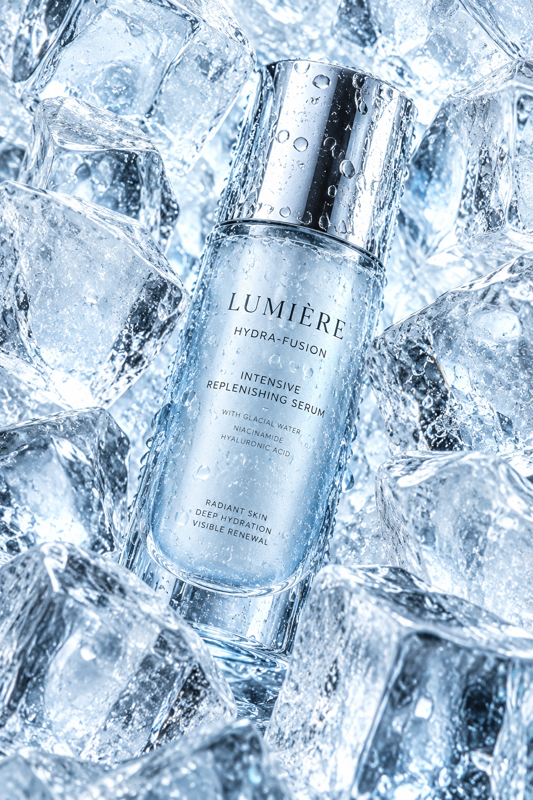

# 评测报告：图像-冰块包裹护肤品商业静物-0xbisc

> 开源分享硬门槛：本页必须能直接看见成图。缺图 = 不可 PR。
> 对应提示词：[图像-冰块包裹护肤品商业静物-0xbisc](图像-冰块包裹护肤品商业静物-0xbisc.md)

## Prompt

```text
Hyper-realistic luxury skincare product shot with a random cosmetic container design as the clear hero object, floating at the center with a slight diagonal tilt. Numerous medium-to-large crystal-clear ice blocks fully surround and wrap the product from all directions, filling the frame edge to edge, creating a dense frozen environment. The ice pieces overlap in depth, pressing visually toward the product without forming a base or pedestal. High-key pale icy blue, near-white background, strong cool backlighting and top lighting producing sharp highlights, refractions, and glassy transparency. The product remains the sharpest focal point, ice slightly softer, visible cold condensation droplets, ultra-detailed, premium cosmetic advertising photography, cold tech aesthetic, photorealistic.
```

## Fixture

- `fixture`：无 MAIN；Codex B 成图
- `fixture_source`：`official`
- `model` / 跑台：gpt-6-astra medium · Codex image_gen · 2026-10-20 · search-20261020-b3

## 成图（必嵌）

### B 成图



## 摘要

Codex `image_gen` pass；四闸过后人判全收。B 成图内嵌。

## 判定

**accepted** — 可进 baize-prompts；读者可见 Prompt + 视觉证据。
