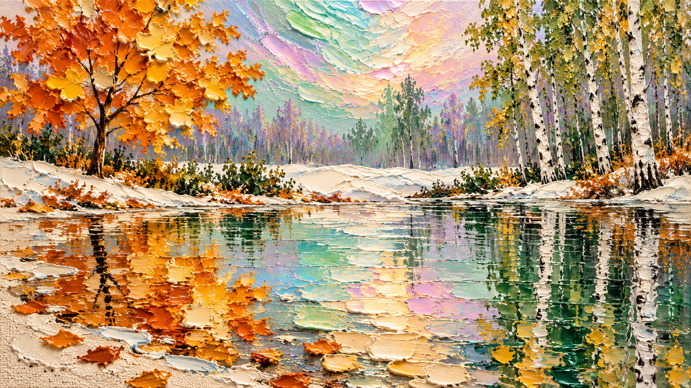

# 评测报告：图像-厚涂刮刀枫树湖景油画-churvikv

> 开源分享硬门槛：本页必须能直接看见成图。缺图 = 不可 PR。
> 对应提示词：[图像-厚涂刮刀枫树湖景油画-churvikv](图像-厚涂刮刀枫树湖景油画-churvikv.md)

## Prompt

```text
Extremely thick impasto oil painting on rough grainy ground, sculptural palette-knife paint standing up in real three-dimensional petals and slabs, wide 16:9 panoramic composition. Edge to edge, no frame, no border.

SKY: a luminous iridescent sky fills the upper middle, washed in soft pastel lavender, mint green, pale turquoise, blush pink and peach, shimmering like mother-of-pearl and crinkled foil. Behind it, distant slender tree trunks fade into a pale violet and green haze.

LEFT: the hero, one young maple tree in brilliant golden-orange, its leaves raised into thick knife-petals of amber, ochre, burnt orange and pale yellow, each leaf a sculpted curl catching light, thin dark branches rising from a narrow trunk.

RIGHT: a stand of slender birches, white trunks marked with rough black dashes, crowned with small green and yellow leaves in crisp short dabs, rising to the top edge.

MIDDLE: a pale bank of drifted snow and cream ground runs between the trees, cracked into heavy ridges, with low green shrubs and dry orange leaves lying along the waterline.

WATER: the bottom half is a still flooded surface reflecting everything above in broken marbled bands — slabs of gold, amber and white for the maple, long vertical green and white streaks for the birches, and a wide band of iridescent mint, pink and turquoise at the centre. The reflections lie as separate thick paint slabs, each edged with a bright rim.

GROUND: bare areas of unpainted canvas show as pale cream, coarse and grainy, scattering the lower corners and left edge with heavy texture.

PALETTE: golden amber, burnt orange, ivory cream, pale mint, turquoise, blush pink, soft violet, deep green, black. Heavy tactile ridges, glossy thick paint, clean and unmarked.
```

## Fixture

- `fixture`：无 MAIN；Codex B 成图
- `fixture_source`：`official`
- `model` / 跑台：gpt-6-astra medium · Codex image_gen · 2026-10-20 · search-20261020-b7

## 成图（必嵌）

### B 成图



## 摘要

Codex `image_gen` pass；四闸过后人判全收。B 成图内嵌。

## 判定

**accepted** — 可进 baize-prompts；读者可见 Prompt + 视觉证据。
