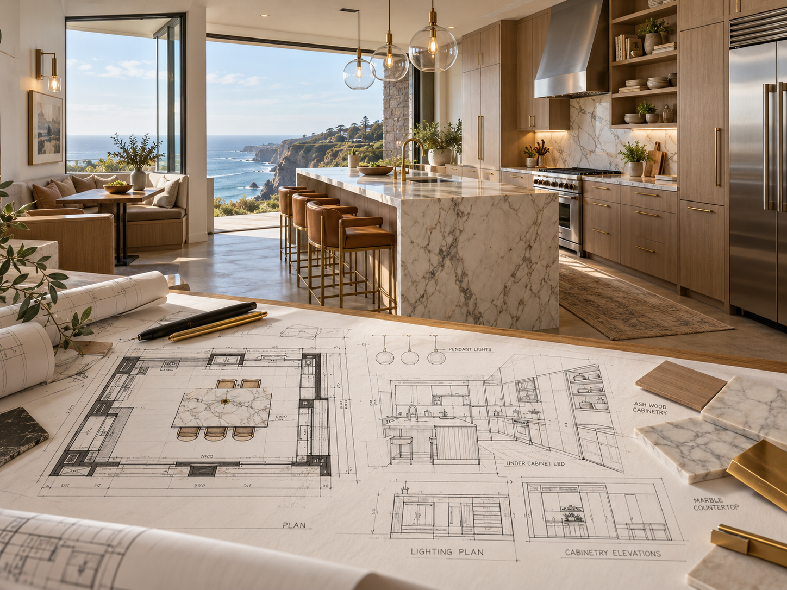

# 评测报告：图像-厨房剖面图纸到成品过渡-PatriciaCoelhoV

> 开源分享硬门槛：本页必须能直接看见成图。缺图 = 不可 PR。
> 对应提示词：[图像-厨房剖面图纸到成品过渡-PatriciaCoelhoV](图像-厨房剖面图纸到成品过渡-PatriciaCoelhoV.md)

## Prompt

```text
Photorealistic 3d cross section of a contemporary galley kitchen with a view to the sea below from the top of a cliff. The foreground schematic drawing shows the plans of the cabinetry and lighting scattered around the paper, smoothly transitioning to a editorial photograph of the finished kitchen with a waterfall marble island in the center, the brass and caramel leather stools beside it, the stainless steel appliances, and ash wood cabinetry and shelving. Three clear glass pendant lights in a row over marble countertops. A banquette on the breakfast nook on the left side. Wide angle shot --c 12 --ar 4:3 --s 100 --v 7.0
```

## Fixture

- `fixture`：无 MAIN；Codex B 成图
- `fixture_source`：`official`
- `model` / 跑台：gpt-6-astra medium · Codex image_gen · 2026-10-20 · search-20261020-b3

## 成图（必嵌）

### B 成图



## 摘要

Codex `image_gen` pass；四闸过后人判全收。B 成图内嵌。

## 判定

**accepted** — 可进 baize-prompts；读者可见 Prompt + 视觉证据。
