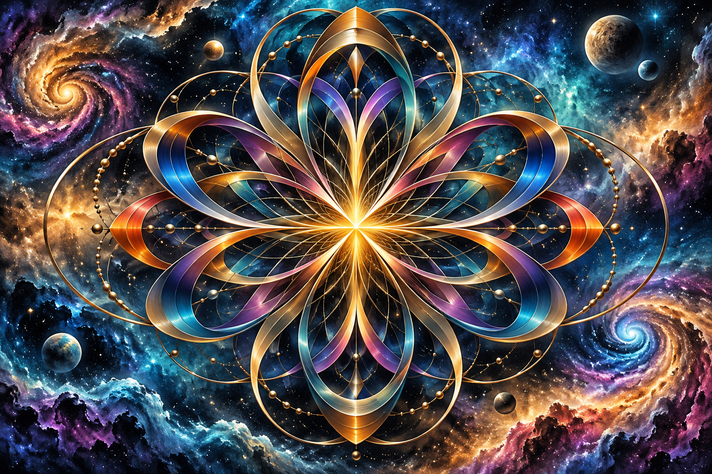

# 评测报告：图像-参数方程抽象喷绘分形-icreatelife

> 开源分享硬门槛：本页必须能直接看见成图。缺图 = 不可 PR。
> 对应提示词：[图像-参数方程抽象喷绘分形-icreatelife](图像-参数方程抽象喷绘分形-icreatelife.md)

## Prompt

```text
A highly detailed airbrush painting, using a parametric equation to create captivating art, x(t) = A * cos(a * t) * cos(t) + A * sin(b * t) * cos(t) and y(t) = A * cos(a * t) * sin(t) + A * sin(b * t) * sin(t), where 'A', 'a', and 'b' are constants, and 't' ranges from 0 to 2π. By experimenting with different values for 'A', 'a', and 'b', you can generate a variety of intriguing and visually appealing designs, combine this with other artistic elements and styles to create a captivating abstract design --ar 3:2
```

## Fixture

- `fixture`：无 MAIN；Codex B 成图
- `fixture_source`：`official`
- `model` / 跑台：gpt-6-astra medium · Codex image_gen · 2026-10-20 · search-20261020-b9

## 成图（必嵌）

### B 成图



## 摘要

Codex `image_gen` pass；四闸过后人判全收。B 成图内嵌。

## 判定

**accepted** — 可进 baize-prompts；读者可见 Prompt + 视觉证据。
