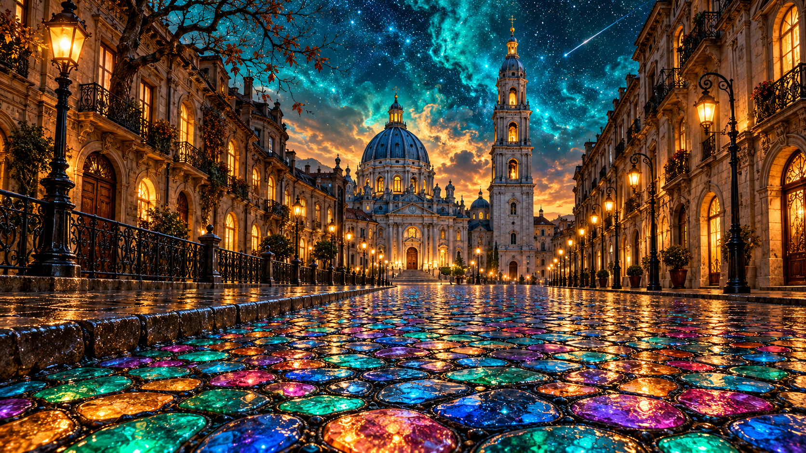

# 评测报告：图像-发光彩石老城街夜景一点透视-churvikv

> 开源分享硬门槛：本页必须能直接看见成图。缺图 = 不可 PR。
> 对应提示词：[图像-发光彩石老城街夜景一点透视-churvikv](图像-发光彩石老城街夜景一点透视-churvikv.md)

## Prompt

```text
Photorealistic magical old-town street at night, wide 16:9 panoramic composition, one-point perspective, cinematic, ultra-detailed. Edge to edge, no frame, no border.
STREET: the entire lower half is a mosaic cobblestone pavement of irregular rounded stones separated by dark joints, split into a central raised walkway with a low kerb on the left. Every stone glows from within like stained glass or opal — saturated turquoise and emerald flowing into cobalt blue, magenta, violet, warm amber and orange, each stone a separate luminous cell with wet cracks and bright glossy reflective highlights.
TOWERS: at the vanishing point, dead centre, stands a grand blue-grey church with a large ribbed dome and a slender arcade, and beside it a tall Baroque bell tower of four stacked tiers with arched openings, a cupola and a gold finial, its windows glowing warm amber from inside. Pale warm streetlamps burn along the facade.
LEFT: a curved row of ornate old-European buildings in warm brown stone with lit arched windows, wrought-iron balconies and carved cornices. A black cast-iron railing runs along the kerb. A dark angular lamppost with a glowing lantern stands at the left edge, and a bare crooked tree with sparse brown leaves rises above the rooftops.
RIGHT: a mirrored row of tall classical facades in the same warm stone, with a row of streetlamps on curved arms marching into the distance, glowing amber, and deep arched doorways lit gold from within.
SKY: the upper third is a deep cosmic teal and turquoise night sky, richly nebulous and swirling, scattered with countless tiny stars. A pale meteor trail streaks diagonally across the upper right. Low warm clouds glow peach and amber behind the towers at the horizon.
PALETTE: turquoise, cobalt, emerald, magenta, violet, warm amber, brown stone, near-black shadow. Sharp focus, glossy wet highlights, high dynamic range, clean and unmarked.
```

## Fixture

- `fixture`：无 MAIN；Codex B 成图
- `fixture_source`：`official`
- `model` / 跑台：gpt-6-astra medium · Codex image_gen · 2026-10-20 · search-20261020-b7

## 成图（必嵌）

### B 成图



## 摘要

Codex `image_gen` pass；四闸过后人判全收。B 成图内嵌。

## 判定

**accepted** — 可进 baize-prompts；读者可见 Prompt + 视觉证据。
