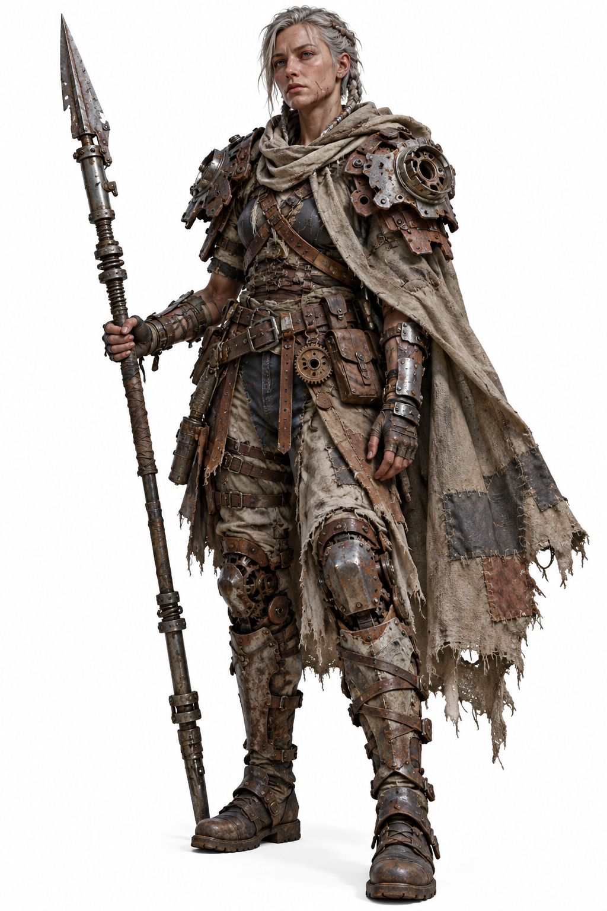

# 评测报告：图像-废铁机甲冒险者3D渲染模板-azed_ai

> 开源分享硬门槛：本页必须能直接看见成图。缺图 = 不可 PR。
> 对应提示词：[图像-废铁机甲冒险者3D渲染模板-azed_ai](图像-废铁机甲冒险者3D渲染模板-azed_ai.md)

## Prompt

```text
A highly detailed cinematic 3D character render of [fantasy adventurer], wearing [armor design] crafted from recycled warforged robot parts, featuring [facial features], [hairstyle], [weapon], [weathered clothing], rusted mechanical plates, exposed gears, damaged robotic components, intricate armor construction, exhausted facial expression, guarded posture reflecting years of warfare, realistic PBR materials, detailed skin textures, metallic surface imperfections, stylized realistic proportions, dramatic studio lighting, Unreal Engine 5 aesthetic, full-body character design, clean white background
```

## Fixture

- `fixture`：无 MAIN；Codex B 成图
- `fixture_source`：`official`
- `model` / 跑台：gpt-6-astra medium · Codex image_gen · 2026-10-20 · search-20261020-b3

## 成图（必嵌）

### B 成图



## 摘要

Codex `image_gen` pass；四闸过后人判全收。B 成图内嵌。

## 判定

**accepted** — 可进 baize-prompts；读者可见 Prompt + 视觉证据。
