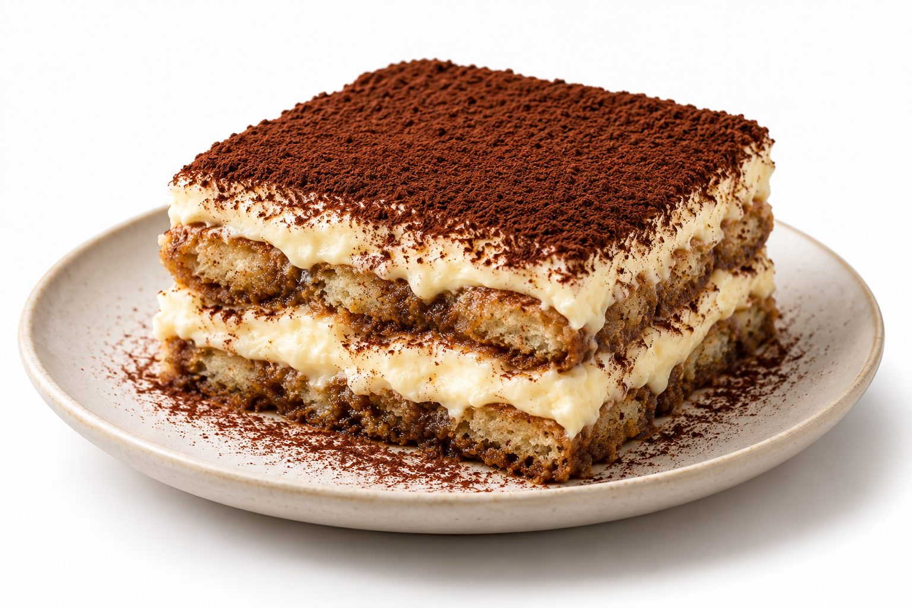

# 评测报告：图像-提拉米苏白底餐饮摄影-HeyRu0by

> 开源分享硬门槛：本页必须能直接看见成图。缺图 = 不可 PR。
> 对应提示词：[图像-提拉米苏白底餐饮摄影-HeyRu0by](图像-提拉米苏白底餐饮摄影-HeyRu0by.md)

## Prompt

```text
Ultra-realistic professional food photography of a classic Italian tiramisu elegantly served on a minimal matte ceramic plate. Perfectly defined layers of espresso-soaked ladyfingers and rich, velvety mascarpone cream, with a thick, perfectly even coating of finely sifted dark cocoa powder on top. The tiramisu should have an authentic homemade yet premium restaurant-quality appearance, with clearly visible internal layers and realistic proportions.

Clean seamless white studio background, soft diffused natural-looking studio lighting, subtle gentle shadows beneath the plate, delicate highlights reflecting naturally across the mascarpone cream. Highly detailed textures: porous espresso-infused sponge, smooth and creamy mascarpone, fine cocoa particles, slightly irregular natural edges, realistic moisture and density.

Centered composition, elegant minimalist plating, shallow depth of field while keeping the tiramisu and its distinct layers in sharp focus, cinematic food styling, sophisticated luxury restaurant aesthetic, photorealistic color grading, natural contrast, true-to-life textures, extremely detailed, crisp focus, high dynamic range, 8K ultra-high resolution.

Negative prompt: text, typography, labels, logos, watermark, hands, people, utensils, cutlery, napkins, table decorations, extra props, fruit, chocolate pieces, excessive garnish, artificial colors, oversaturated tones, plastic-looking cream, unrealistic layers, distorted plate, messy presentation, low resolution, blur, noise, CGI appearance, cartoon, illustration, duplicate objects, cropped dessert.
```

## Fixture

- `fixture`：无 MAIN；Codex B 成图
- `fixture_source`：`official`
- `model` / 跑台：gpt-6-astra medium · Codex image_gen · 2026-10-20 · search-20261020-b6

## 成图（必嵌）

### B 成图



## 摘要

Codex `image_gen` pass；四闸过后人判全收。B 成图内嵌。

## 判定

**accepted** — 可进 baize-prompts；读者可见 Prompt + 视觉证据。
