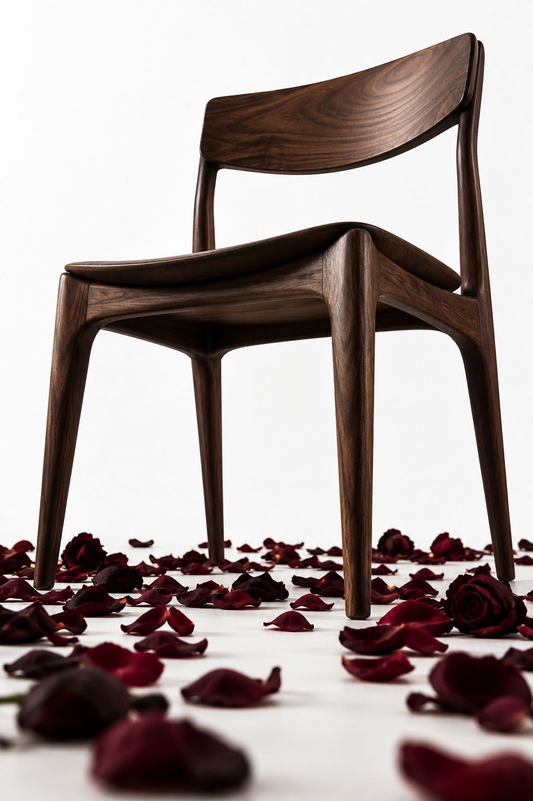

# 评测报告：图像-深色木椅低机位棚拍-AiwithAlyar

> 开源分享硬门槛：本页必须能直接看见成图。缺图 = 不可 PR。
> 对应提示词：[图像-深色木椅低机位棚拍-AiwithAlyar](图像-深色木椅低机位棚拍-AiwithAlyar.md)

## Prompt

```text
A sleek, low-angle studio shot featuring a dark wood chair centered against a solid, seamless white backdrop. The composition highlights crisp craftsmanship and clean lines, grounded by a dramatic scatter of dark floral petals around the base. Soft, controlled studio lighting accentuates the natural wood grain while maintaining a high-contrast, modern aesthetic. Ideal for high-end furniture concepts, dramatic product staging, and contemporary interior design editorials.
```

## Fixture

- `fixture`：无 MAIN；Codex B 成图
- `fixture_source`：`official`
- `model` / 跑台：gpt-6-astra medium · Codex image_gen · 2026-10-20 · search-20261020-b6

## 成图（必嵌）

### B 成图



## 摘要

Codex `image_gen` pass；四闸过后人判全收。B 成图内嵌。

## 判定

**accepted** — 可进 baize-prompts；读者可见 Prompt + 视觉证据。
