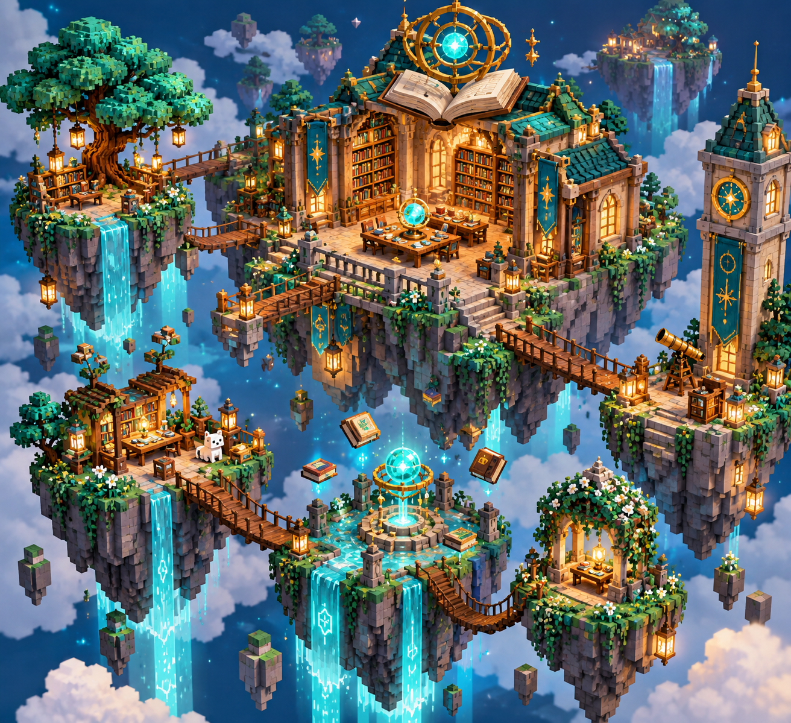

# 评测报告：图像-等距微缩世界占位模板-azed_ai

> 开源分享硬门槛：本页必须能直接看见成图。缺图 = 不可 PR。
> 对应提示词：[图像-等距微缩世界占位模板-azed_ai](图像-等距微缩世界占位模板-azed_ai.md)

## Prompt

```text
An isometric 3D miniature world themed around [subject], featuring stylized terrain, iconic props, tiny environmental details, and glowing accents in [color1] and [color2]. Clean geometry, crisp edges, flat shadows, vibrant colors, highly detailed micro-world design, pixel-diorama aesthetic, playful and immersive composition.
```

## Fixture

- `fixture`：无 MAIN；Codex B 成图
- `fixture_source`：`official`
- `model` / 跑台：gpt-6-astra medium · Codex image_gen · 2026-10-20 · search-20261020-b3

## 成图（必嵌）

### B 成图



## 摘要

Codex `image_gen` pass；四闸过后人判全收。B 成图内嵌。

## 判定

**accepted** — 可进 baize-prompts；读者可见 Prompt + 视觉证据。
