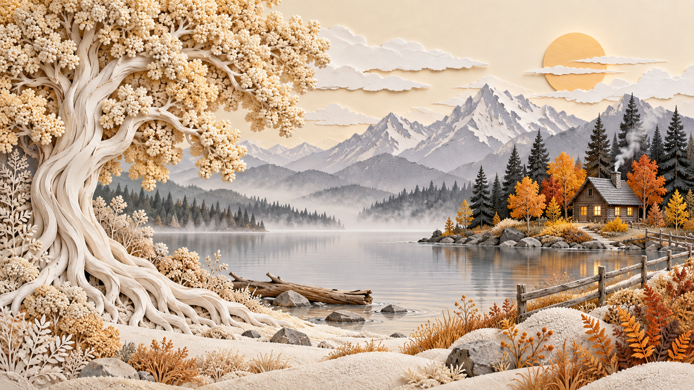

# 评测报告：图像-纸雕浮雕湖畔小屋全景-churvikv

> 开源分享硬门槛：本页必须能直接看见成图。缺图 = 不可 PR。
> 对应提示词：[图像-纸雕浮雕湖畔小屋全景-churvikv](图像-纸雕浮雕湖畔小屋全景-churvikv.md)

## Prompt

```text
Layered papercut relief wall art, hand-cut cardstock and textured foam clay, wide 16:9 panoramic composition, soft studio light raking across the surface to reveal real physical depth. Edge to edge, no frame, no border, no plaque.

LEFT: a giant tree fills the left third, its white and cream bark sculpted into sinuous twisting ribbons that flow down into a broad network of pale roots spreading across the lower left corner. The canopy above is a dense mass of pale champagne-beige clay florets in tight beaded clusters, built up in many tiny raised balls like sugarwork. Pale sculpted shrubs cluster around the roots.

CENTRE: a calm pale grey lake lies flat and hazy across the middle, its shoreline dissolving into soft mist. A driftwood log and a few flat stones rest in the shallows, with a low white sandy bank in the foreground.

RIGHT: on a small island bank sits a small wooden cabin with a steep grey roof, a dark chimney and a lit window, ringed by rocks, golden-green grass and a cluster of brilliant autumn orange and gold trees. A rustic wooden post-and-rail fence runs from the cabin island across the right foreground, its rails cut into slim layered strips.

TREES RIGHT: tall dark charcoal spruce silhouettes rise behind the cabin, sharply serrated, backed by a jagged mountain range in grey-lavender layers, snow-lit edges fading into pale haze.

SKY: an even cream-beige sky, cloud banks sculpted as flat stacked white layers with torn rounded edges. In the upper right, a pale golden-orange sun disc sits low, partly veiled by two thin white cloud strips that cross it.

FOREGROUND: the pale ground rolls into soft rounded clay mounds with stippled grain, dry rust-brown grasses and orange fern fronds on the right, each a separate cut shape with visible edges and thin drop shadows.

PALETTE: ivory cream, champagne beige, pale grey, charcoal, autumn orange and gold. Matte handmade finish, clean and unmarked.
```

## Fixture

- `fixture`：无 MAIN；Codex B 成图
- `fixture_source`：`official`
- `model` / 跑台：gpt-6-astra medium · Codex image_gen · 2026-10-20 · search-20261020-b3

## 成图（必嵌）

### B 成图



## 摘要

Codex `image_gen` pass；四闸过后人判全收。B 成图内嵌。

## 判定

**accepted** — 可进 baize-prompts；读者可见 Prompt + 视觉证据。
